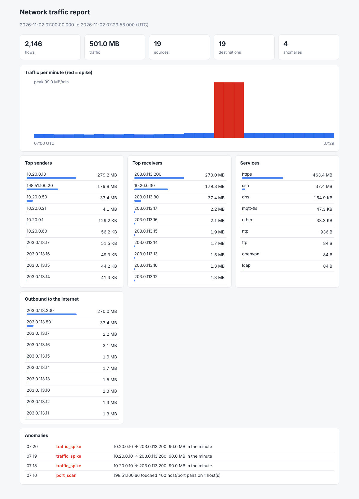
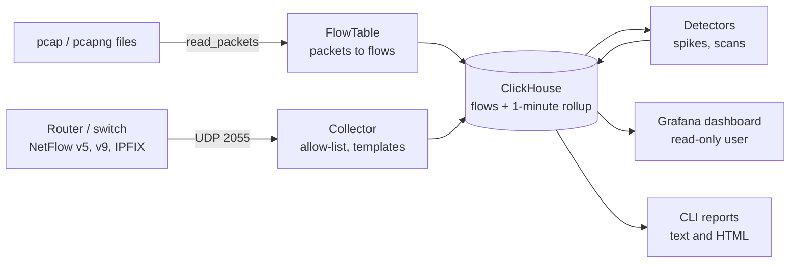

# flowpipe: network traffic pipeline

[](https://github.com/TexAlphaWolf/ana-network-traffic-pipeline/actions/workflows/ci.yml)
[](https://github.com/TexAlphaWolf/ana-network-traffic-pipeline/actions/workflows/codeql.yml)


Turn network traffic into answers: **who talks the most, to which services, and when
something unusual happens.** flowpipe reads **pcap/pcapng captures** and **NetFlow v5/v9/IPFIX**
exports, stores them as flows in **ClickHouse**, finds **traffic spikes and port scans**, and
ships a ready-made **Grafana** dashboard.



*The text and HTML reports (`flowpipe report`) on the built-in sample: a 90 MB/min upload
(red) and a port scan from the internet are found without any hand-written rule.*

## Why this exists

A home or small-office network produces plenty of traffic data, but a router shows a few
counters and nothing about history. Commercial flow analysers are heavy. This project is the
small, auditable version: no agents, no Python dependencies at runtime (standard library only),
and every number can be traced back to a SQL query you can read.

## Quick start

You need Docker with Compose. Nothing else.

```bash
git clone https://github.com/TexAlphaWolf/ana-network-traffic-pipeline.git
cd ana-network-traffic-pipeline
cp .env.example .env        # then set the three passwords (openssl rand -base64 24)
#   Linux: also add  FLOWPIPE_USER=$(id -u):$(id -g)  to .env
docker compose up -d --build

# Synthetic traffic: 30 minutes of an office day with two incidents hidden in it
docker compose run --rm flowpipe sample pcap /captures/office.pcap
docker compose run --rm flowpipe ingest /captures/office.pcap
docker compose run --rm flowpipe anomalies
```

Open <http://localhost:3000> (user `admin`, the password you set) and look at
**Dashboards → Network → Network traffic**. `docker compose run --rm flowpipe report` prints the
same numbers in the terminal.

On Windows, run the same commands in PowerShell with Docker Desktop (use
`copy .env.example .env` for the first step). The sample contains only documentation and
private addresses; nothing in it is real.

## Using your own data

### From a capture file

```bash
sudo tcpdump -i eth0 -s 96 -w captures/today.pcap       # 96 bytes per packet are enough
docker compose run --rm flowpipe ingest /captures/today.pcap
```

Wireshark/dumpcap files work too (`.pcap`, `.pcapng`, and `.gz` of both). Loading the same file
twice does nothing (it is recognised by its SHA-256). To load files continuously, let tcpdump
rotate them and watch the folder:

```bash
sudo tcpdump -i eth0 -s 96 -G 300 -w 'captures/cap-%Y%m%d-%H%M%S.pcap' &
docker compose run --rm flowpipe watch /captures
```

### From a router or switch (NetFlow / IPFIX)

Set `FLOWPIPE_ALLOWED_EXPORTERS` in `.env` to the exporter's address, start the collector, and
point the device's flow export at `<this host>:2055/udp`:

```bash
docker compose --profile netflow up -d
```

The collector accepts only the exporters you list and refuses to start on a network address
without that list. Many consumer routers cannot export flows; on a Linux server you can export
them yourself with `softflowd` or `pmacct` from a mirrored port or a bridge.

You can try the collector without any router. Add the Compose network to
`FLOWPIPE_ALLOWED_EXPORTERS` for the test (`docker network inspect` shows its range, often
`172.16.0.0/12`), then:

```bash
docker compose run --rm flowpipe sample send collector 2055 --format ipfix
```

### Privacy

Flow data shows who talks to whom. Set `FLOWPIPE_ANONYMISE_KEY` and every address is replaced
by a keyed pseudonym before it is stored: the same host always gets the same pseudonym, so the
top-talker analysis still works, and the internal/external split is kept. Without the key the
mapping cannot be reversed. Use it for any data you share or publish.

## What you get

| | |
|---|---|
| **Sources** | pcap, pcapng (any byte order, µs/ns timestamps, VLAN tags, IPv4 and IPv6 with extension headers), NetFlow v5, v9, IPFIX over UDP |
| **Storage** | ClickHouse, with a one-minute rollup table (materialized view), TTL retention, compression codecs |
| **Detection** | Traffic spikes (rolling median/MAD, robust to the spike itself) and port scans (one source touching many host/port pairs) |
| **Reports** | Terminal and self-contained HTML (`flowpipe report`), top talkers, protocols, services, outbound destinations |
| **Dashboard** | Grafana, provisioned from files: traffic by service, shares, top senders/receivers, outbound, anomalies |
| **Safety** | Untrusted-input parsers, exporter allow-list, separate writer and read-only database users |

## Commands

```text
flowpipe init-db                       create the database and tables
flowpipe ingest FILE...                load pcap/pcapng files (--force to load again)
flowpipe watch FOLDER                  load capture files as they appear
flowpipe collect                       receive NetFlow v5/v9/IPFIX on UDP 2055
flowpipe anomalies [--last 6h]         find spikes and scans (stored; re-running is safe)
flowpipe top [--by src|dst|pair]       top talkers
flowpipe report [--format html -o f]   summary report
flowpipe status                        what is in the database
flowpipe sample pcap|send ...          synthetic traffic, for demos and tests
```

Time windows: `--last 90m|6h|7d`, or `--since` / `--until` with an ISO time (UTC).

## Architecture



More detail, including the schema and the detection maths, is in
[docs/architecture.md](docs/architecture.md). Every setting is listed in
[docs/configuration.md](docs/configuration.md).

## Development

```bash
python -m venv .venv && . .venv/bin/activate     # Windows: .venv\Scripts\Activate.ps1
pip install -e ".[dev]"
ruff check . && ruff format --check . && mypy
pytest --cov
```

The tests that need a database run on a real ClickHouse engine. Without a server, install the
embedded engine (`pip install chdb`) and they use it; with a server, set
`FLOWPIPE_TEST_CLICKHOUSE=http://localhost:8123` (and `FLOWPIPE_TEST_USER` /
`FLOWPIPE_TEST_PASSWORD`). CI runs every test against ClickHouse 26.8 and then brings up the
whole Compose stack (ClickHouse, Grafana, collector) and checks it end to end. See
[CONTRIBUTING.md](CONTRIBUTING.md).

## Known limitations

- flowpipe does not capture packets itself: use `tcpdump`/`dumpcap` or a NetFlow exporter.
  Capturing needs privileges and platform drivers that do not belong in an analysis tool.
- Flows built from a pcap are unidirectional and use idle/active timeouts (15 s / 60 s by
  default), like a router's flow cache. Very long connections appear as several flows.
- NetFlow v9/IPFIX options templates and enterprise-specific fields are skipped.
  Counters from sampled v5 exports are scaled by the sampling interval; for v9/IPFIX, only the
  `samplingInterval` element is honoured.
- Spike detection works on total traffic per minute. It needs about 8 minutes of history and is
  tuned for networks with fairly regular traffic; adjust `FLOWPIPE_SPIKE_*` for yours.
- The Grafana dashboard queries ClickHouse over the native protocol through the official plugin,
  which Grafana downloads on first start (the host needs internet access once).

## License

MIT - Luca Tessitore
